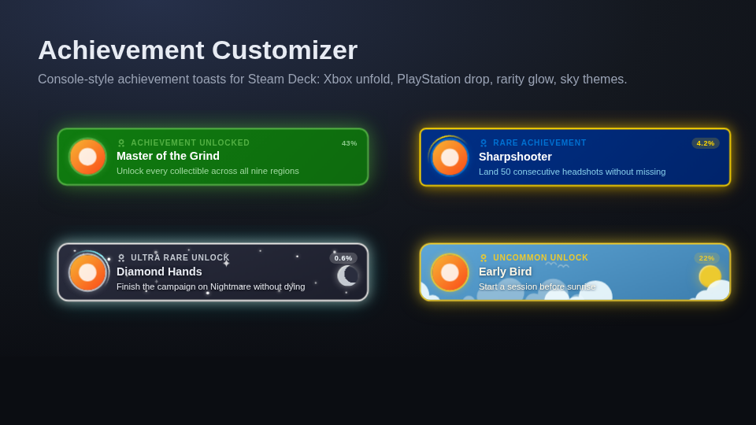
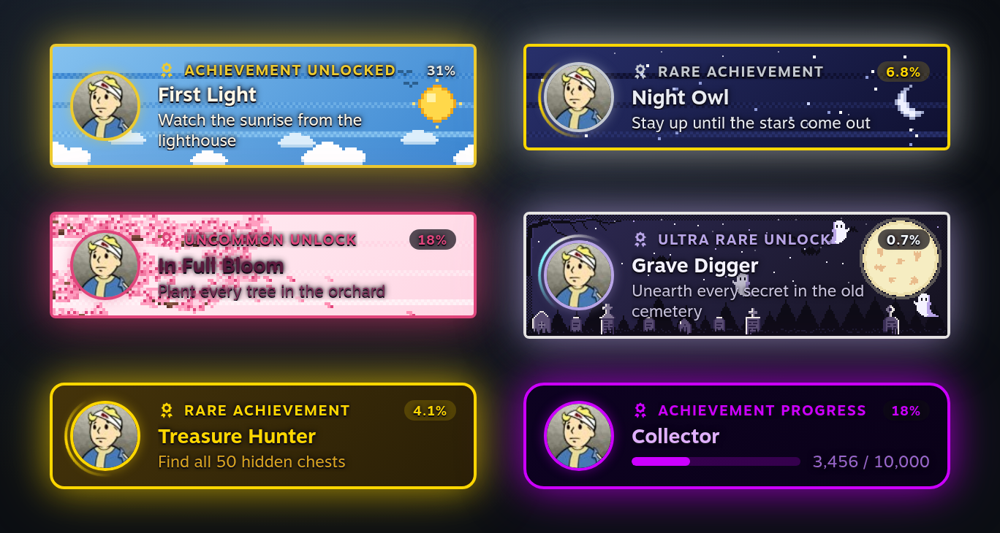
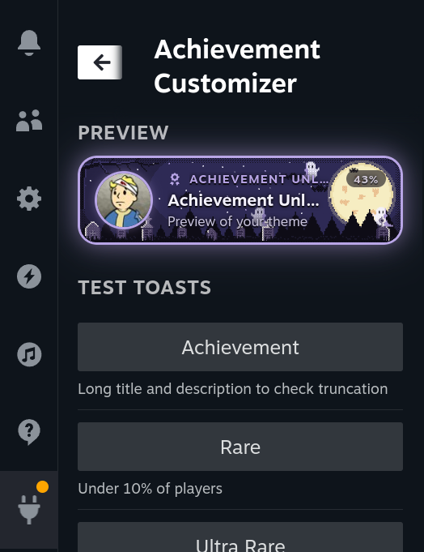

# Achievement Customizer

Achievement Customizer is a [Decky Loader](https://github.com/SteamDeckHomebrew/decky-loader)
plugin that gives your Steam Deck achievement pop-ups the look and feel of a console unlock.
It takes over Steam's own notification right where it appears, so there's nothing to time, unlocks
never show up twice, and the toast you preview in the Quick Access menu is exactly the one you get
in game.



## Animations that feel like home

Pick the entrance you grew up with. **Unfold** pops the icon in as an Xbox-style disc, opens the card
out of it and folds it back up when it leaves. **Drop** settles in from above like on a PlayStation,
with a sweep of light around the icon. There's also Slide, Pop, Bounce, Fade, Flip and **Retro**, a
16-bit text box that opens in chunky steps.

Every entrance comes with its own matching exit, and slides always come in from whichever edge of
the screen Steam is showing toasts on.

## Themes

Twelve presets get you started: Xbox, PlayStation, Steam, Nintendo, Gold, Midnight, Sky Day, Sky
Night, Pixel Day, Pixel Night, Cherry Blossom and Halloween. Each one brings its own colors, shape
and entrance.



You can also put a little animated scene behind the text, with any theme you like. There's a
simple sparkle overlay, drifting clouds and a warm sun by day, twinkling stars and a crescent moon
by night, and 16-bit pixel versions of both with birds, a shooting star and plenty of sparkle.
Cherry Blossom fills the card with blossoming branches and drifting petals. Halloween is a moonlit
graveyard with bats, ghosts, a twisted old tree and a row of tombstones. The skies are painted from
your Primary and Secondary colors, so if you change them, the whole scene changes with you.

## Rarity and progress

Toasts show what share of players have the achievement. Anything under 25% is called out as
uncommon, under 10% earns a gold ring and glow, and under 1% gets the diamond treatment. When you
make progress on an achievement without unlocking it yet, the toast shows a progress bar instead of
the description.

## Make it yours



Everything lives in the Quick Access menu. You can change the primary, secondary, accent, title and
description colors, choose a gradient, solid or glass banner, and tweak the icon shape and border,
corner rounding, glow strength, shine sweep and how long the toast stays on screen.

The preview at the top replays your changes as you make them. The test buttons send real
achievement notifications through Steam, so you see and hear exactly what an unlock will look like
without anything piling up in your notification tray.

If you've turned on Reduce Motion in Steam (Settings › Accessibility), toasts fade gently instead of
moving around. Switch on **Animate anyway** in the plugin if you'd still like the full animations.

## Compatibility

Works in Game Mode on both the stable and beta versions of SteamOS. If you're on the beta, make sure
Decky Loader is on version 3.3.0 or newer, since older versions can't show any plugins there.

## Installation

The plugin hasn't been reviewed by the Decky plugin team yet, so it isn't in the plugin store. Until
it is, you can install it yourself in a couple of minutes, right from Game Mode. You'll need
[Decky Loader](https://github.com/SteamDeckHomebrew/decky-loader) installed first.

### Turn on Developer mode

Open the Quick Access menu, go to the Decky tab and tap the gear icon. Under **General**, switch on
**Developer mode**. A new **Developer** page shows up in the same settings menu, and that's where
both install options live.

### Install from a URL

This is the quickest way, since there's nothing to download yourself.

1. In Decky's settings, open **Developer**.
2. Under **Install Plugin from URL**, enter this address:

   ```
   https://github.com/Hector2242/decky-plugin/releases/latest/download/achievement-customizer.zip
   ```

3. Tap **Install**, then tap **Install** again when Decky asks you to confirm.

### Install from a ZIP file

1. Download `achievement-customizer.zip` from the
   [latest release](https://github.com/Hector2242/decky-plugin/releases/latest). If you grab it on
   another computer, copy it over to your Deck first (the Downloads folder is a good spot).
2. In Decky's settings, open **Developer** and tap **Browse** next to **Install Plugin from ZIP
   File**.
3. Pick the zip, then tap **Install** when Decky asks you to confirm.

Either way, Achievement Customizer shows up in your Decky plugin list a few seconds later, ready to
go.

### Updating

When a new version comes out, install it the same way you installed the first one. If you used the
URL, that's the very same address again, since it always points at the newest release. Decky swaps
the old version out for the new one and your colors and theme stay just the way you left them, so
there's no need to uninstall anything first.

Decky doesn't announce updates for plugins installed this way. If you'd like to hear about new
versions, click **Watch** on the [GitHub repo](https://github.com/Hector2242/decky-plugin) and choose
**Custom → Releases**.

## License

BSD-3-Clause. Built on the [decky-plugin-template](https://github.com/SteamDeckHomebrew/decky-plugin-template),
and the original template license is kept in `LICENSE`.
