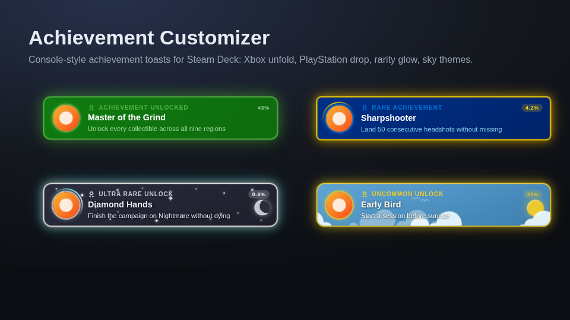
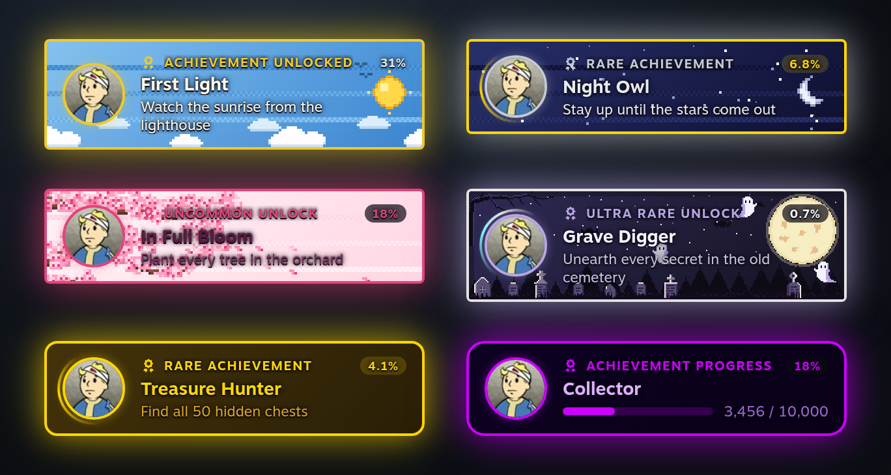
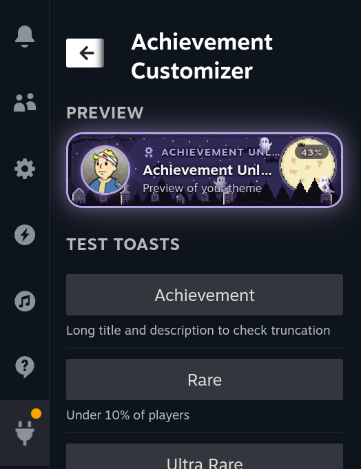

# Achievement Customizer

Achievement Customizer is a [Decky Loader](https://github.com/SteamDeckHomebrew/decky-loader)
plugin that gives your Steam Deck achievement pop-ups the look and feel of a console unlock.
It takes over Steam's own notification right where it appears, so there's nothing to time, unlocks
never show up twice, and the toast you preview in the Quick Access menu is exactly the one you get
in game.



## Animations that feel like home

Pick the entrance you grew up with. **Xbox One** pops the achievement icon in as a disc in the
middle of the toast, then the banner grows out of it while the text slides up, and it all shrinks
back into the disc when it leaves. **Drop** settles in like on a PlayStation, with a sweep of light
around the icon. There's also Slide, Pop, Bounce, Fade, Flip and **Retro**, a 16-bit text box that
opens in chunky steps.

Every entrance comes with its own matching exit, and they always come in from the nearest edge of
the screen.

## Position

Put toasts in any corner or in the middle of the top or bottom edge. Steam shows all of its
notifications in the same spot, so friend and download notifications move there too.

## Themes

Twelve presets get you started: Xbox, PlayStation, Steam, Nintendo, Gold, Midnight, Sky Day, Sky
Night, Pixel Day, Pixel Night, Cherry Blossom, Halloween and Hoth. Each one brings its own colors, shape
and entrance.



You can also put a little animated scene behind the text, with any theme you like. There's a
simple sparkle overlay, drifting clouds and a warm sun by day, twinkling stars and a crescent moon
by night, and 16-bit pixel versions of both with birds, a shooting star and plenty of sparkle.
Cherry Blossom fills the card with blossoming branches and drifting petals. Halloween is a moonlit
graveyard with bats, ghosts, a twisted old tree and a row of tombstones. Hoth is a snowfield where an
AT-AT walks and fires red lasers at two X-wings that dive in to attack: one is shot down, the other
climbs away. The skies are painted from
your Primary and Secondary colors, so if you change them, the whole scene changes with you.

## Trophy tiers and progress

Toasts show what share of players have the achievement and turn it into a trophy: gold under 15%,
silver under 50% and bronze for the rest. Platinum is saved for the achievement that completes a
game (100%), like on PlayStation. Gold and platinum also get a ring of light and a glow. Halfway
through the toast, the achievement icon turns into its trophy, so each gets about half the time on
screen, and you can choose how: it can spin, get eaten from corner
to corner by a swarm of little pixel aliens, get blasted by lasers and blown apart in a pixel explosion
or drown in dripping blood that slowly turns into the colors of its tier. **Show trophy only** skips the icon and shows the trophy right away. You can switch the reveal or the tiers off, and both choices stay put when you switch presets. When you make progress on an achievement
without unlocking it yet, the toast shows a progress bar instead of the description.

## Make it yours



Everything lives in the Quick Access menu. You can change the primary, secondary, accent, title and
description colors, choose a gradient, solid or glass banner, and tweak the icon shape and border,
corner rounding, glow strength, shine sweep and how long the toast stays on screen.

The preview at the top replays your changes as you make them. The test buttons send real
achievement notifications through Steam, so you see and hear exactly what an unlock will look like
without anything piling up in your notification tray.

Toasts play their full animations by default, even with Reduce Motion on in Steam (Settings ›
Accessibility). Turn off **Animate anyway** in the plugin if you'd rather have them fade gently.

## Achievement Creation

Want a different layout, like the PS3's trophy icon, "You have earned a trophy" on top and a cup next
to the title? Tap **Achievement Creation** in the Quick Access menu to open a full-screen editor with
the toast blown up over a grid. Tap a part (icon, badge, label, title, description or the card
itself) to select it, drag it along the grid with a finger and pinch to make it bigger or smaller.
The sliders below set exact sizes and positions, and you can tap their numbers to type a value, so
everything also works with the controller when your Deck is docked. The badge, label and
description can be hidden. **Reset layout** brings back the standard one.

From the same page you can:

- rename the line above the title for each tier ("Bronze trophy", "Achievement unlocked" and so on),
- replace the trophy the icon turns into with your own picture, a different one for bronze, silver,
  gold and platinum if you like (PNG, JPG, WebP or GIF up to 1 MB; Trophy Reveal has to be on),
- play your own sound instead of Steam's achievement sound (MP3, OGG or WAV up to 2 MB). It follows
  Steam's own setting for notification sounds and stops when the toast leaves.

### Your own presets

The built-in presets (Xbox, PlayStation, Hoth and the rest) never change. If you tweak anything
while one of them is picked, the preset list shows **Custom** and the built-in one stays exactly as
it was. To keep your version, tap **Save as new preset** in Achievement Creation and give it a name:
it becomes your very own preset, listed in the Quick Access preset menu next to the built-in ones.
While your preset is picked, every change saves into it, and you can rename or delete it there too.
Picking a built-in preset always brings back its original look.

## Screenshot on unlock

Turn on **Screenshot on Unlock** in the Quick Access menu and every unlock saves a picture of your
game with the achievement pop-up on it, named after the game and the achievement, in
`Pictures/Achievement Screenshots`. Steam doesn't let plugins add pictures to its own Media, so they
stay in that folder: open it in Desktop Mode or copy it to your PC. Test toasts take one too, so you
can check it works.

## Compatibility

Works in Game Mode on both the stable and beta versions of SteamOS. If you're on the beta, make sure
Decky Loader is on version 3.3.0 or newer, since older versions can't show any plugins there.

## Installation

The plugin hasn't been reviewed by the Decky plugin team yet, so it isn't in the plugin store. Until
it is, you can install it yourself in a couple of minutes, right from Game Mode. You'll need
[Decky Loader](https://github.com/SteamDeckHomebrew/decky-loader) installed first.

### Turn on Developer mode

Open the Quick Access menu, go to the Decky tab and tap the gear icon. Under **General**, switch on
**Developer mode**. A new **Developer** page shows up in the same settings menu, and that's where
both install options live.

### Install from a URL

This is the quickest way, since there's nothing to download yourself.

1. In Decky's settings, open **Developer**.
2. Under **Install Plugin from URL**, enter this address:

   ```
   https://github.com/Hector2242/decky-plugin/releases/latest/download/achievement-customizer.zip
   ```

3. Tap **Install**, then tap **Install** again when Decky asks you to confirm.

### Install from a ZIP file

1. Download `achievement-customizer.zip` from the
   [latest release](https://github.com/Hector2242/decky-plugin/releases/latest). If you grab it on
   another computer, copy it over to your Deck first (the Downloads folder is a good spot).
2. In Decky's settings, open **Developer** and tap **Browse** next to **Install Plugin from ZIP
   File**.
3. Pick the zip, then tap **Install** when Decky asks you to confirm.

Either way, Achievement Customizer shows up in your Decky plugin list a few seconds later, ready to
go.

### Updating

When a new version comes out, install it the same way you installed the first one. If you used the
URL, that's the very same address again, since it always points at the newest release. Decky swaps
the old version out for the new one and your colors and theme stay just the way you left them, so
there's no need to uninstall anything first.

Decky doesn't announce updates for plugins installed this way. If you'd like to hear about new
versions, click **Watch** on the [GitHub repo](https://github.com/Hector2242/decky-plugin) and choose
**Custom → Releases**.

## License

BSD-3-Clause. Built on the [decky-plugin-template](https://github.com/SteamDeckHomebrew/decky-plugin-template),
and the original template license is kept in `LICENSE`.
